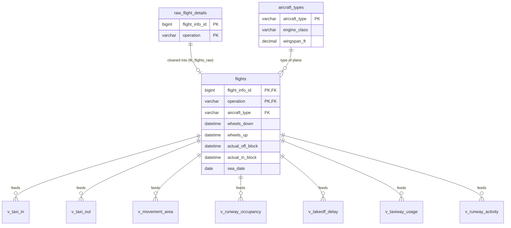

# SeaTac AI database guide (`seatac`)

**For:** team members working on or using the new database **Branch:** `test_1` · **Status:** built, checked and tested (99 tests pass, 1 intentional skip) **Related docs in the repo:** [DB_SCHEMA.md](DB_SCHEMA.md) (full column list), [DATA_CHANGES.md](DATA_CHANGES.md) (old vs new data), [CLIENT_CONFIRMED_RULES.md](CLIENT_CONFIRMED_RULES.md) (the Port’s rules), [SETUP_GUIDE.md](SETUP_GUIDE.md) (setup), [DEVELOPER_GUIDE.md §2.8](DEVELOPER_GUIDE.md#28-testing) (tests)

---

## 1. What this database is

The Port of Seattle sent an updated export of one operating day at SEA (Aug 8, 2025): **1,061 flight legs × 585 columns** in one Excel sheet. A chatbot can’t use that reliably, so we turned it into a database where:

- each flight leg is one clean row with a real unique key
- only Seattle-side times are used
- every one of the Port’s 10 questions has a ready-made **view** that applies the Port’s confirmed rules

The chatbot will only query these views. It never writes joins or guesses formulas.

## 2. Quick start

```bash
git fetch && git checkout test_1
cd src/database
python3.12 -m venv venv && source venv/bin/activate
pip install -r requirements.txt
cd scripts
python load_aerobahn.py --file /path/to/August_8_and_9_2025_Anonymized.xlsx   # builds seatac
python check_seatac.py                                                         # verifies it
python create_reader.py                                                        # creates the read-only user
cd .. && pytest -q                                                             # runs the test suite
```

- The **Excel file is private.** Get it from the team drive, and never commit it.
- `load_aerobahn.py` **drops and rebuilds** `seatac` every time. It refuses to touch `AIplane` or `AIplane_v2`.
- MySQL settings come from `src/backend/.env` (`DB_HOST`, `DB_PORT`, `DB_USER`, `DB_PASSWORD`).
- Before running `create_reader.py`, add your own random password as `SEATAC_READER_PASSWORD=` in `src/backend/.env`. It’s the password for the read-only user `seatac_reader` (see `docs/DEVELOPER_GUIDE.md` §2.8).

## 3. The big picture: three layers

| Layer | Objects | Purpose |
| --- | --- | --- |
| **1. Raw** | `raw_flight_details` | The export as-is (every column with data). For checking and future questions. The chatbot never reads it |
| **2. Clean** | `flights`, `aircraft_types` | Only what the questions need, with clear names and Seattle-side times only |
| **3. Views** | `v_taxi_in`, `v_taxi_out`, … | One calculator per question, with the Port’s rules and exclusion reasons built in |



---

## 4. Tables

### 4.1 `raw_flight_details`

- **Rows:** 1,061 (one per flight leg)
- **Columns:** the 223 columns that have data, with their original Excel names. The 362 empty columns are skipped.
- **Key:** `flight_info_id` + `operation`. These are the original `Flight Info ID` and `Operation` columns, renamed, because MySQL treats `Operation` and `operation` as the same name.
- **Use it for:** checking a number against the source, or finding a column for a future question.

### 4.2 `flights`: the main table

**One row per flight leg at SEA:** 525 arrivals, 535 departures and 1 missed approach.

| Column | Type | From the Excel column | Meaning |
| --- | --- | --- | --- |
| `flight_info_id` | BIGINT, PK | Flight Info ID | Unique flight entry ID |
| `operation` | VARCHAR, PK, CHECK | Operation | Arrival, Departure or Missed Approach (enforced by `chk_flights_operation`) |
| `call_sign` | VARCHAR | Call Sign | Anonymized call sign. **Not unique**; never join on it |
| `carrier` | VARCHAR | Carrier | Anonymized airline (QTA, ZYX) |
| `carrier_group` | VARCHAR | Carrier Group | QTA, ZYX or Cargo |
| `aircraft_type` | VARCHAR, FK | Aircraft Type (FAA) | Links to `aircraft_types`. NULL for 3 legs (the views label them `Unknown` in `aircraft_type_group`) |
| `weight_class_icao` | CHAR(1) | Weight Class (ICAO) | M = medium, H = heavy (no light aircraft) |
| `origin_airport` | VARCHAR | Origination Airport | Where the leg starts |
| `destination_airport` | VARCHAR | Destination Airport | Where the leg ends |
| `international_domestic` | VARCHAR | International or Domestic Indicator | Domestic or International |
| `runway` | VARCHAR | Runway | SEA runway (34R, 34L, 34C, 16L, 16R, 16C) |
| `gate` | VARCHAR | Gate Assigned (Aerobahn) | SEA gate |
| `parking_area` | VARCHAR | Parking Area | e.g. `ParkingArea_NorthSatellite` |
| `taxiway_runway` | VARCHAR | Taxiway Used to Enter/Exit Runway | Segment code, e.g. `TaxiwaySegment_B_28` |
| `taxiway_ramp` | VARCHAR | Taxiway Used to Enter/Exit Ramp | Segment code |
| `scheduled_off_block` | DATETIME | Scheduled Off Block Time (Aerobahn) | Departures only |
| `actual_off_block` | DATETIME | Actual Off Block Time (Aerobahn) | Departures only: left the gate |
| `scheduled_take_off` | DATETIME | Scheduled Take Off Time (Aerobahn) | Departures only |
| `wheels_up` | DATETIME | Wheels Up | Departures only: liftoff |
| `scheduled_landing` | DATETIME | Scheduled Landing Time (Aerobahn) | Arrivals only |
| `wheels_down` | DATETIME | Wheels Down | Arrivals only: touchdown |
| `scheduled_in_block` | DATETIME | Scheduled In Block Time (Aerobahn) | Arrivals only |
| `actual_in_block` | DATETIME | Actual In Block Time (Aerobahn) | Arrivals only: parked at the gate |
| `runway_entrance` | DATETIME | Runway Entrance Time | Departures only |
| `runway_exit` | DATETIME | Runway Exit Time | Arrivals only |
| `movement_area_entrance` | DATETIME | Movement Area Entrance Time | Departures only |
| `movement_area_exit` | DATETIME | Movement Area Exit Time | Arrivals only |
| `sea_event_time` | DATETIME | Event Time | The main SEA event: wheels down (arrivals) or wheels up (departures). For the missed approach, the export’s SEA event time |
| `sea_date` | DATE | (calculated) | Local date of `sea_event_time` |
| `passenger_count` | INT | Passenger Count (AODB) | Some missing |
| `sys_taxi_in_sec` | INT | Actual Taxi In Time | The export’s own value, **for cross-checking only** |
| `sys_taxi_out_sec` | INT | Actual Taxi Out Time | Cross-checking only |
| `sys_runway_occupancy_sec` | INT | Runway Occupancy Time | Cross-checking only |
| `source_file` | VARCHAR | (load info) | Which file the row came from |

**The Seattle-side rule:** the export also holds times at the *other* airport, e.g. an arrival’s off-block at its origin. In `flights` these are set to NULL, so they can’t be mixed up with Seattle times. The originals stay in `raw_flight_details`. The missed approach follows the arrival rule.

All times are **Seattle local time (PDT), exactly as exported**: never converted or shifted. No daylight-saving change falls inside this data.

### 4.3 `aircraft_types`

- **Rows:** 16, one per FAA aircraft type. **Key:** `aircraft_type`.
- **Columns:** `engine_class`, `wake_category`, `design_group`, `wingspan_ft`, `fuselage_ft`, `max_takeoff_weight_kg`, `max_landing_weight_kg`.
- **When the export disagrees,** the most common value is used. E75L is the biggest case: about 93 of 340 legs show a different wake category and wingspan, likely two Embraer 175 variants under one code.

## 5. Keys and relationships

| Relationship | Type | Why |
| --- | --- | --- |
| `flights.aircraft_type` → `aircraft_types.aircraft_type` | Many to one (FK) | Many flights share one plane type; specs aren’t repeated |
| `flights` → `raw_flight_details` on (`flight_info_id`, `operation`) | One to one (FK `fk_flights_raw`) | Every clean row provably comes from one source row |

**Why the key is `flight_info_id` + `operation`:**

- Call signs repeat: 927 call signs across 1,061 legs.
- `flight_info_id` alone repeats twice: one arrival + departure pair and one arrival + missed approach pair.
- With `operation` added, every row is unique.

**Constraints and indexes:**

- `operation` is limited to Arrival, Departure and Missed Approach by CHECK constraints on both tables (`chk_raw_operation`, `chk_flights_operation`).
- `flights` has indexes on `aircraft_type`, `sea_date`, `operation` and `runway`.
- The selection timestamps aren’t indexed yet, on purpose: the slowest view takes 37 ms on 1,061 rows. Revisit with live data.

---

## 6. Views

Every per-flight view has the columns below (the helper views `v_movement_area_hourly_peak`, `v_peak_hours` and `v_weight_classes` are summaries or fixed lists, without per-row exclusions):

- a duration or value column (seconds, plus minutes where useful)
- an **`exclusion_reason`** column: empty if the flight is included, otherwise why it’s left out
- **`selection_time`, `selection_date` and `selection_hour`**: the time that decides which day and hour a flight belongs to, following the Port’s selection rules (e.g. off-block for Q2, interval start for Q4)
- grouping labels where needed: **`aircraft_type_group`** and **`weight_class_group`**, which show a missing value as `Unknown`

Averages and counts are taken only over rows where `exclusion_reason IS NULL`.

| View | Questions | Flights | Calculation | Current rows / included |
| --- | --- | --- | --- | --- |
| `v_taxi_in` | Q1, Q6, Q8 | Arrivals | `wheels_down` → `actual_in_block` | 525 / 525 |
| `v_taxi_out` | Q2, Q6 | Departures | `actual_off_block` → `wheels_up`, with off-block date and hour | 535 / 535 |
| `v_movement_area` | Q3 | Both | Arrivals: `wheels_down` → `movement_area_exit`. Departures: `movement_area_entrance` → `wheels_up` | 1,060 / 1,052 |
| `v_movement_area_hourly_peak` | Q3 | Both | Highest number of aircraft in the movement area at once, per local hour (helper view) | 25 hourly rows |
| `v_runway_occupancy` | Q4 | Both | Arrivals: `wheels_down` → `runway_exit`. Departures: `runway_entrance` → `wheels_up` | 1,060 / 1,054 |
| `v_takeoff_delay` | Q5 | Departures | `wheels_up` − `scheduled_take_off`, in minutes; negative (early) kept | 535 / 533 |
| `v_taxiway_usage` | Q7 | Both | One row per flight per segment used, with `taxiway_letter`, `taxiway_name` (e.g. Bravo) and `segment_number` | 2,120 / 2,102 |
| `v_runway_activity` | Q9, Q10 | Both | One row per SEA takeoff or landing, with runway, local date and hour; missed approach flagged | 1,061 / 1,059 |
| `v_peak_hours` | Q10 | Both | Takeoffs plus landings per local hour, ranked within each day with `RANK()`, so ties share a rank | 23 hourly rows |
| `v_weight_classes` | Q6 | n/a | A fixed list (L, M, H, Unknown), so an empty class like Light shows “No data” | 4 rows |

**Exclusion reasons:** `missing time`, `negative duration`, `missing scheduled take-off` and `missing take-off` (Q5), `missing segment` (Q7), `missing runway` (per-runway counts) and `missed approach` (Q9/Q10). In the current data, `negative duration` and `missing take-off` never occur; the other five do.

**How the Q3 hourly peak works:** each interval becomes a +1 at entry and a −1 at exit, plus a 0 marker at every clock hour. At the same second, exits are processed first, then markers, then entries. A running sum gives the number present, and the view takes the maximum per hour. So entry counts and exit doesn’t, nobody is counted twice at a handover, and aircraft already inside count in every hour they’re present.

### Q7 section-entry times are provisional

The export has no time per taxiway section, so `v_taxiway_usage` uses the closest available time as a provisional selection time. For a departure, that’s the movement-area entrance (ramp side) or the runway entrance (runway side). For an arrival, it’s the runway exit (runway side) or the movement-area exit (ramp side). This stays marked provisional until the Port confirms it.

## 7. Rules every view follows

From `docs/CLIENT_CONFIRMED_RULES.md`, confirmed by the Port:

- Identify flights by `flight_info_id` + `operation`, never by call sign.
- Seattle local time; keep full dates across midnight; days run midnight to midnight.
- Time windows include the start and exclude the end.
- Prefer Aerobahn timestamps (confirmed for Q2’s off-block time).
- Exclude missing start/end times and negative durations, and report how many and why. Negative takeoff delay is valid (early).
- Keep zero and very long durations. There’s no upper cutoff and no 1–120 minute filter.
- No minimum group size. Always show the sample size.
- Calculate at full precision; show averages rounded to 2 decimals.
- Show “No data” for a group with no eligible flights, never 0.

## 8. One flight, all the way through

**Arrival QTA409** (B39M from ORD, runway 16R, gate `Gate_N10`). Another arrival also uses call sign QTA409, which is why call signs are never a key:

1. **Excel:** 585 columns about this flight.
2. **`flights`:** `wheels_down` 00:01:27, `runway_exit` 00:01:46, `actual_in_block` 00:16:54. Its departure time from Chicago is NULL here.
3. **`v_taxi_in`:** 00:16:54 − 00:01:27 = 15.45 minutes, `exclusion_reason` empty, so included.
4. **`v_runway_occupancy`:** 00:01:46 − 00:01:27 = 19 seconds, included.

## 9. How the chatbot will use it

1. The AI matches a question to a metric in `src/database/metric_rules.yaml` (e.g. `taxi_in`, grouped by aircraft type).
2. The code fills a fixed SQL template against the matching view:

   ```sql
   SELECT aircraft_type_group, ROUND(AVG(duration_min), 2) AS avg_minutes, COUNT(*) AS flights
   FROM v_taxi_in
   WHERE exclusion_reason IS NULL
   GROUP BY aircraft_type_group
   ORDER BY aircraft_type_group;
   ```
3. The answer shows the definition, the sample size and the exclusions.

This gives the same question the same SQL and the same numbers every time. The chatbot should connect as the **read-only user `seatac_reader`**, which can read the views but not the tables or other databases. It’s created by `create_reader.py` and covered by the tests.

---

## 10. Design decisions

| Decision | Why |
| --- | --- |
| Keep three layers | Raw for traceability, clean for clarity, views for the rules |
| Key = `flight_info_id` + `operation` | Call signs repeat; the ID alone repeats twice |
| `flights` holds Seattle-side times only | Prevents other-airport times leaking into Seattle answers |
| Specs in a separate `aircraft_types` table | No repeated data |
| Rules live in views, not in the AI prompt | Same answer every time; no AI-written joins |
| `exclusion_reason` on every view | The Port wants reasons and sample sizes shown |
| Use `Wheels Down`, never Actual Landing | The Port’s instruction |
| Q4 ignores Clear Active | The Port’s instruction; our values are shorter than the export’s on purpose |
| Q2 uses the Aerobahn off-block time | Confirmed by the Port; differs from the export’s AODB-based taxi-out by about 6 minutes |
| Keep `Aircraft Type (FAA)` | The AODB type is empty for 238 legs; the Port’s FAA/SWIM rule is about events |
| No upper cutoff on durations | The Port says to keep long valid durations (e.g. QTA3199, 99 minutes) |
| `operation` limited to 3 values by a CHECK constraint | The loader fails loudly if a future export has a new or misspelled value |
| `aircraft_type_group` shows `Unknown` for a missing type | Q1 shows an honest Unknown group instead of a blank one; `aircraft_type` itself stays NULL |
| Selection timestamps not indexed yet | The slowest view takes 37 ms on 1,061 rows; revisit with live data |

## 11. Known limits and open questions

| Item | Status |
| --- | --- |
| One SEA day only (Aug 8) | Second day requested from the Port |
| Q3: mapping events to the Port’s hatched-area boundary; re-entries not visible (one interval per leg) | Asked the Port |
| Q7: no per-segment time; Tango, Hotel and Whiskey don’t appear; `B_SSR` meaning unknown | Asked the Port; provisional proxy times used |
| E75L variant conflict in `aircraft_types` | Documented; doesn’t affect Q1 or Q6 |
| Is `flight_info_id` unique across days? | Asked the Port |

## 12. Files

| File | What it is |
| --- | --- |
| `src/database/scripts/load_aerobahn.py` | Builds `seatac` from the Excel file |
| `src/database/scripts/check_seatac.py` | Checks counts, keys, dates, exclusions, old vs new. Never prints answers |
| `src/database/scripts/build_aiplane_v2.py` | Builds `AIplane_v2`, the new data in the old layout, for the baseline test |
| `src/database/scripts/create_reader.py` | Creates the read-only user `seatac_reader` |
| `src/database/tests/` | The automated test suite (run `pytest -q` from `src/database`) |
| `docs/seatac_schema.sql` | Structure-only export of the schema (no data), for ER diagram tools |
| `src/database/sql/seatac_views.sql` | All view definitions |
| `src/database/metric_rules.yaml` | Each metric’s definition, view, groupings and limits, plus the Q1–Q10 index |
| `src/database/requirements.txt` | Python packages for the scripts |
| `docs/DB_SCHEMA.md` | Full schema, including all 223 raw columns and check results |

---

## 13. Testing

Run `pytest -q` from `src/database`. The current result is **99 passed, 1 skipped** (the intentional selection-timestamp index test). Details are in `docs/DEVELOPER_GUIDE.md` §2.8.

| Area | What it checks |
| --- | --- |
| Structure | Keys, foreign keys, NOT NULL, the `operation` CHECK, indexes |
| Integrity | Counts match Excel, unique key, every row has a raw row, the Seattle-side rule, times identical to Excel |
| Rules | Every view matches an independent pandas recalculation from the Excel file, flight by flight |
| Edge cases | Midnight crossings, missing times, QTA3199, the missed approach, the leg with no runway (out of Q9, in Q10), the shared ID, Unknown groups, “No data”, ties, on-the-hour events, the 76-second example |
| Reproducibility and determinism | Rebuilding gives identical tables; each view returns identical rows twice |
| Speed | Every view under 500 ms (slowest 37 ms) |
| Security | `seatac_reader` can read the views only, and can’t change anything |
| Privacy | No identifier columns or values in any view |

The tests rebuild `seatac` (never `AIplane` or `AIplane_v2`), and need `SEATAC_READER_PASSWORD` in `src/backend/.env`.

**Important:** `tests/excel_expected.py` was written alongside the views, so it isn’t an independent answer key. The Validation team’s hand-calculated expected answers are the real proof, so calculate those without looking at this file.

## 14. How to contribute

### Rules

- **Never commit** the Excel file, any database dump, `.env` or logs.
- **Don’t print metric averages or final answers** in scripts or messages. The Validation team calculates expected answers independently.
- **Don’t change `AIplane` or `AIplane_v2`.**
- **Follow the Port’s rules exactly.** If a rule is unclear, ask in the team chat before guessing.

### Workflow

1. Pull `test_1` and create your own branch, e.g. `db-views-q5`.
2. Make small changes and small commits.
3. Rebuild and check: `python load_aerobahn.py --file …`, then `python check_seatac.py` and `pytest -q`.
4. Update the docs in the same change (`DB_SCHEMA.md`, `metric_rules.yaml` and this guide if needed).
5. Open a pull request into `test_1` and ask a teammate to review.

### Checklist for changing or adding a view

- [ ] The calculation matches `docs/CLIENT_CONFIRMED_RULES.md`
- [ ] It works flight by flight, keyed on `flight_info_id` + `operation`
- [ ] It has an `exclusion_reason` for every left-out case
- [ ] It uses Seattle-side columns only
- [ ] It has no cutoffs the Port didn’t ask for
- [ ] `metric_rules.yaml` is updated (definition, view, groupings, limits)
- [ ] `check_seatac.py` and `pytest -q` pass, and the row counts make sense
- [ ] The decision and reason are added to the decisions table

## 15. Glossary

| Term | Meaning |
| --- | --- |
| Flight leg | One trip: one takeoff and one landing |
| Off-block / in-block | Leaving / arriving at the gate (chocks off / on) |
| Wheels up / wheels down | Liftoff / touchdown |
| Taxi-in / taxi-out | Touchdown → gate / gate → takeoff |
| Movement area | The ATC-controlled runways and taxiways |
| Missed approach | An aircraft that aborted a landing and went around |
| Aerobahn | The Port’s surface management system (preferred source) |
| AODB | The airport operational database |
| ICAO weight class | M = medium, H = heavy |
| Taxiway segment | e.g. `TaxiwaySegment_B_28` = taxiway Bravo, segment 28 |