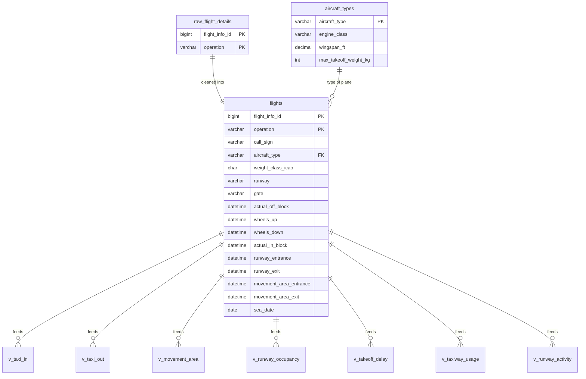

# Database Schema — `seatac` (MySQL)

> What is in the new database, where every column comes from, and how the metric views are defined.
> Related docs: [DATA_CHANGES.md](DATA_CHANGES.md) (old vs new data) · [SETUP_GUIDE.md](SETUP_GUIDE.md) (load it) · [DEVELOPER_GUIDE.md](DEVELOPER_GUIDE.md) · Team 6's old database: [legacy/DB_SCHEMA_TEAM6.md](legacy/DB_SCHEMA_TEAM6.md)
>
> **Source data:** the Port of Seattle's Aerobahn export `August_8_and_9_2025_Anonymized.xlsx` (one sheet, 1,061 rows × 585 columns). **It is private and not in this repo.** Neither is any dump of this database: it contains real tail numbers and transponder codes. Built by [`src/database/scripts/load_aerobahn.py`](../src/database/scripts/load_aerobahn.py). Numbers below were verified on 2026-10-19 with [`check_seatac.py`](../src/database/scripts/check_seatac.py).
>
> ⚠️ **The chatbot does not use this database yet.** It still queries Team 6's `AIplane` until it is switched to these views.

---

## The three layers

```
 Excel export (585 columns)
        │  load_aerobahn.py
        ▼
 1. raw_flight_details   every non-empty column (223), original names        ← nothing lost
        │
        ▼
 2. flights              one row per leg at SEA, 34 clean columns, SEA-side times only
    aircraft_types       one row per FAA aircraft type (16)
        │
        ▼
 3. metric views         v_taxi_in, v_taxi_out, v_movement_area (+ hourly peak), v_runway_occupancy,
                         v_takeoff_delay, v_taxiway_usage, v_runway_activity
                         → each row says whether it is used (exclusion_reason) — rules in metric_rules.yaml
```



**Scope:** all 1,061 legs have `sea_date` = **2025-08-08** (the day's SEA events; the file name says "August 8 and 9" because some other-airport times fall on Aug 9). All times are **local PDT, stored as `DATETIME` and never shifted**.

---

## Keys and relationships

| Table | Primary key | Notes |
|---|---|---|
| `raw_flight_details` | (`flight_info_id`, `operation`) | Same key as `flights`, one-to-one |
| `flights` | (`flight_info_id`, `operation`) | **Unique** (0 duplicates). `flight_info_id` alone repeats for **2** IDs: one Arrival + Departure pair and one Arrival + Missed Approach pair, which is why `operation` is part of the key |
| `aircraft_types` | `aircraft_type` | `flights.aircraft_type` → `aircraft_types.aircraft_type` is a real foreign key (`fk_flights_aircraft_type`). It allows NULL for the **3** legs with no FAA type. 0 orphans |

**Join rule:** always join on both `flight_info_id` **and** `operation`. Call signs are not a key.

---

## 1. `raw_flight_details` — the untouched export

- **One row per export row** (1,061). It holds **every column that has at least one value: 221 export columns + the 2 key columns = 223**. The other 362 export columns are completely empty and are skipped.
- **Original column names are kept** (e.g. `` `Wheels Down (PDT)` ``; quote them with backticks). The one exception: **`Flight Info ID` → `flight_info_id` and `Operation` → `operation`**. MySQL column names are case-insensitive, so `Operation` and `operation` can't both exist, and the originals are renamed rather than duplicated.
- **Types are inferred** from the values: 90 `DATETIME`, 14 `TIME` (h:mm:ss durations), 22 `BIGINT`, 4 `DOUBLE`, 6 `TINYINT(1)` (true/false) and 86 `TEXT`. Columns that mix types are stored as text, e.g. the delay columns, where negative durations come as text like `-00:08:00`.
- **Other-airport times are kept here** (for example an arrival's off-block time at its origin). They are removed only in `flights`.
- The full column list (name, type, filled rows) is in the [appendix](#appendix-raw_flight_details-columns).

---

## 2. `flights` — one clean row per leg at SEA

525 arrivals · 535 departures · 1 missed approach = **1,061 legs**.

> **`flights` holds SEA-side times only.** Times that belong to the *other* airport are set to NULL. For arrivals that's `scheduled_off_block`, `actual_off_block`, `scheduled_take_off` and `wheels_up`. For departures it's `scheduled_landing`, `wheels_down`, `scheduled_in_block` and `actual_in_block`. **The missed approach follows the arrival rule** (it is an inbound flight). The original values stay in `raw_flight_details`. The loader blanked 524–525 arrival values and 533 departure values per column, plus 3 on the missed approach.

| Column | Type | Source Excel column | Meaning | Filled (Arr / Dep / MA) |
|---|---|---|---|---|
| `flight_info_id` | BIGINT, PK | Flight Info ID | Aerobahn's flight record ID | 525 / 535 / 1 |
| `operation` | VARCHAR(20), PK | Operation | `Arrival`, `Departure` or `Missed Approach` | 525 / 535 / 1 |
| `call_sign` | VARCHAR(20) | Call Sign | Radio call sign (anonymised, e.g. `QTA3199`). **Not unique** | all |
| `carrier` | VARCHAR(20) | Carrier | Airline code (anonymised) | all |
| `carrier_group` | VARCHAR(50) | Carrier Group | Airline group | all |
| `aircraft_type` | VARCHAR(20), FK | Aircraft Type (FAA) | FAA type code (e.g. `B738`, `E75L`) | 524 / 533 / 1 |
| `weight_class_icao` | CHAR(1) | Weight Class (ICAO) | `M` (medium) or `H` (heavy). **No light aircraft** in this data | all |
| `origin_airport` | VARCHAR(10) | Origination Airport | Where the leg started | all |
| `destination_airport` | VARCHAR(10) | Destination Airport | Where the leg ended | all |
| `international_domestic` | VARCHAR(20) | International or Domestic Indicator | International / domestic flag | 524 / 533 / 1 |
| `runway` | VARCHAR(10) | Runway | SEA runway used (16L/16C/16R/34L/34C/34R) | 525 / 534 / 1 |
| `gate` | VARCHAR(30) | Gate Assigned (Aerobahn) | SEA gate. **88 distinct gates** + the placeholder `*ASCG1S` | all |
| `parking_area` | VARCHAR(50) | Parking Area | Ramp area at SEA | 521 / 534 / 1 |
| `taxiway_runway` | VARCHAR(50) | Taxiway Used to Enter/Exit Runway | One taxiway segment code (e.g. `TaxiwaySegment_B_28`) | 521 / 534 / 0 |
| `taxiway_ramp` | VARCHAR(50) | Taxiway Used to Enter/Exit Ramp | One taxiway segment code | 520 / 528 / 0 |
| `scheduled_off_block` | DATETIME | Scheduled Off Block Time (Aerobahn) (PDT) | Planned pushback at SEA | 0 / 535 / 0 |
| `actual_off_block` | DATETIME | Actual Off Block Time (Aerobahn) (PDT) | Actual pushback at SEA | 0 / 535 / 0 |
| `scheduled_take_off` | DATETIME | Scheduled Take Off Time (Aerobahn) (PDT) | Planned take-off from SEA | 0 / 533 / 0 |
| `wheels_up` | DATETIME | Wheels Up (PDT) | Actual take-off from SEA (identical to Actual Take Off Time (Aerobahn) on all 535) | 0 / 535 / 0 |
| `scheduled_landing` | DATETIME | Scheduled Landing Time (Aerobahn) (PDT) | Planned landing at SEA | 524 / 0 / 1 |
| `wheels_down` | DATETIME | Wheels Down (PDT) | Touchdown at SEA (identical to Actual Landing Time (Aerobahn) on all 525) | 525 / 0 / 0 |
| `scheduled_in_block` | DATETIME | Scheduled In Block Time (Aerobahn) (PDT) | Planned gate arrival at SEA | 525 / 0 / 1 |
| `actual_in_block` | DATETIME | Actual In Block Time (Aerobahn) (PDT) | Actual gate arrival at SEA | 525 / 0 / 1 |
| `runway_entrance` | DATETIME | Runway Entrance Time (PDT) | Departure enters the runway | 0 / 533 / 0 |
| `runway_exit` | DATETIME | Runway Exit Time (PDT) | Arrival leaves the runway | 521 / 0 / 0 |
| `movement_area_entrance` | DATETIME | Movement Area Entrance Time (PDT) | Departure enters the movement area | 0 / 532 / 0 |
| `movement_area_exit` | DATETIME | Movement Area Exit Time (PDT) | Arrival leaves the movement area | 520 / 0 / 0 |
| `sea_event_time` | DATETIME | Event Time (PDT) | The leg's SEA event time (used for the missed approach) | all |
| `sea_date` | DATE | `DATE(Event Time (PDT))` | Local SEA date; all 2025-08-08 | all |
| `passenger_count` | INT | Passenger Count (AODB) | Passengers on the leg | 514 / 527 / 1 |
| `sys_taxi_in_sec` | INT | Actual Taxi In Time (h:mm:ss → seconds) | The export's own taxi-in, **whole minutes**. ⚠️ On departures it describes the destination airport, so use it only with arrivals | 524 / 533 / 1 |
| `sys_taxi_out_sec` | INT | Actual Taxi Out Time (h:mm:ss → seconds) | The export's own taxi-out, **whole minutes**. ⚠️ On arrivals it describes the origin airport, so use it only with departures | 524 / 533 / 1 |
| `sys_runway_occupancy_sec` | INT | Runway Occupancy Time (h:mm:ss → seconds) | The export's own runway occupancy (defined differently from ours; see the check results) | 521 / 532 / 0 |
| `source_file` | VARCHAR(255) | the file name | Which export the row came from | all |

The three `sys_*` columns are kept for cross-checking only. The metrics use our own definitions (below).

---

## 2b. `aircraft_types` — one row per FAA type

16 types. By number of legs: E75L 340, B739 217, B39M 182, B738 163, A21N 46, BCS1 26, B737 17, A321 16, BCS3 14, A339 10, B38M 8, A359 6, B753 6, A319 4, B752 2, E170 1 (3 legs have no type).

| Column | Type | Source Excel column |
|---|---|---|
| `aircraft_type` | VARCHAR(20), PK | Aircraft Type (FAA) |
| `engine_class` | VARCHAR(20) | Engine Class |
| `wake_category` | VARCHAR(10) | Wake Category (Aerobahn) (the AODB and ATC versions are empty) |
| `design_group` | VARCHAR(10) | Design Group (FAA) |
| `wingspan_ft` | DECIMAL(8,2) | Wingspan (feet) |
| `fuselage_ft` | DECIMAL(8,2) | Fuselage (feet) |
| `max_takeoff_weight_kg` | INT | Maximum Takeoff Weight (kg) |
| `max_landing_weight_kg` | INT | Maximum Landing Weight (kg) |

**When the export disagrees, the most common value wins.** Seven attribute conflicts were found:

| Type | Column | Values in the export (rows) | Stored |
|---|---|---|---|
| **E75L** | wake_category | D (247), **E (93)** | D |
| **E75L** | wingspan_ft | 94.159 (247), 85.301 (93) | 94.159 |
| **E75L** | fuselage_ft | 103.903 (247), 103.936 (93) | 103.903 |
| **E75L** | max_landing_weight_kg | 34000 (306), 34100 (34) | 34000 |
| A359 | max_takeoff_weight_kg | 275000 (4), 280000 (2) | 275000 |
| B738 | fuselage_ft | 129.493 (160), 138.187 (3) | 129.493 |
| BCS3 | fuselage_ft | 114.828 (11), 127 (3) | 114.828 |

> ⚠️ **E75L variant conflict.** About 93 of the 340 E75L legs carry a different wake category (E vs D) and a shorter wingspan (85.3 ft vs 94.2 ft). That looks like **two Embraer E175 variants recorded under one FAA code**. Questions grouped by aircraft type treat them as one type. Weight class (`flights.weight_class_icao`) comes from each leg, so it is not affected.

---

## 3. Metric views

Defined in [`src/database/sql/seatac_views.sql`](../src/database/sql/seatac_views.sql). The chatbot-facing definitions, groupings and limits are in [`src/database/metric_rules.yaml`](../src/database/metric_rules.yaml), which also maps each question (Q1–Q10) to its metric.

**Every view has:**
- `exclusion_reason`: NULL means the row is used. `'missing time'` means the start or end is NULL. `'negative duration'` means end < start (**except `v_takeoff_delay`**, where negative = early and is kept).
- `included`: 1 when `exclusion_reason` is NULL.

Two extra reasons exist where there is no time to be missing: `'missing segment'` in `v_taxiway_usage` and `'missed approach'` in `v_runway_activity`.

| View | Question(s) | Rows | Start → end | Unit |
|---|---|---|---|---|
| `v_taxi_in` | Q1, Q6, Q8 | arrivals | `wheels_down` → `actual_in_block` | minutes |
| `v_taxi_out` | Q2, Q6 | departures | `actual_off_block` → `wheels_up` (plus local date and hour of off-block) | minutes |
| `v_movement_area` | Q3 | arrivals + departures | arr: `wheels_down` → `movement_area_exit`; dep: `movement_area_entrance` → `wheels_up` | minutes |
| `v_movement_area_hourly_peak` | Q3 | one row per local hour | Maximum number of aircraft in the movement area at the same time (sweep over included `v_movement_area` intervals; exits counted before entries at the same second) | count |
| `v_runway_occupancy` | Q4 | arrivals + departures | arr: `wheels_down` → `runway_exit`; dep: `runway_entrance` → `wheels_up` | seconds |
| `v_takeoff_delay` | Q5 | departures | `scheduled_take_off` → `wheels_up`, no threshold, negative = early | minutes |
| `v_taxiway_usage` | Q7 | 2 rows per leg (runway-side + ramp-side segment) | count DISTINCT (`flight_info_id`, `operation`) per `taxiway_segment` | legs |
| `v_runway_activity` | Q9, Q10 | one row per leg | Take-off at `wheels_up` (dep), landing at `wheels_down` (arr), with runway, local date and hour. The missed approach is flagged (`is_missed_approach`) at `sea_event_time` and excluded by default | count |

### Definition decisions and pending items

| Item | Status |
|---|---|
| **Q4 runway occupancy** | **Follows Samer's definition on purpose.** It starts at touchdown (`wheels_down`) for arrivals and ends at `wheels_up` for departures, with **no "Clear Active"**. The export's own `Runway Occupancy Time` is defined differently: **arrivals CrossThreshold → Runway Exit** (matches within 1 s on all 521) and **departures Runway Entrance → Clear Active** (within 1 s on all 532). So our values are systematically shorter than the export's, and that is expected |
| **Q2 taxi-out off-block source** | **PENDING PORT CONFIRMATION.** We use **Aerobahn** off-block. The export's own `Actual Taxi Out Time` reproduces from **AODB off-block → ATC take-off** (mean difference +9 s, all within 60 s). Aerobahn off-block is consistently later, so ours is shorter on 530 of 533 legs |
| **Q3 movement-area boundary** | **PENDING PORT CONFIRMATION:** whether runway time counts as movement-area time (arrivals start at touchdown, departures end at wheels up) |
| **Q7 taxiway names** | **PENDING:** how segment codes map to names like Tango, Hotel and Whiskey. Each leg records only one runway-side and one ramp-side segment, not the whole route |
| **Q10 peak hours** | **History only.** One day of data, no forecasting |
| **Taxi-in source** | Uses Aerobahn in-block, which agrees with Surveillance in-block. The export's own taxi-in uses **AODB in-block**. Of the 3 legs that differ by more than 5 minutes, 2 are AODB in-block running 8–10 min later than Surveillance, and 1 (QTA3199) has an Aerobahn in-block 99 min after touchdown with no other source to confirm it. That leg is currently **included** |

---

## Check results (2026-10-19, `check_seatac.py`)

Counts and differences only. **Metric averages are deliberately not shown**: the team computes expected answers independently.

**Rows and keys:** 1,061 legs (525 / 535 / 1). The key is unique. 2 `flight_info_id` values repeat. Every `sea_date` = 2025-08-08. 16 aircraft types, 3 legs with no type, 0 foreign-key orphans.

| View | Rows | Included | Excluded |
|---|---|---|---|
| v_taxi_in | 525 | 525 | — |
| v_taxi_out | 535 | 535 | — |
| v_movement_area | 1,060 | 1,052 | missing time 8 (arr 5, dep 3) |
| v_runway_occupancy | 1,060 | 1,054 | missing time 6 (arr 4, dep 2) |
| v_takeoff_delay | 535 | 533 | missing time 2 |
| v_taxiway_usage | 2,120 | 2,103 | missing segment 17 |
| v_runway_activity | 1,061 | 1,060 | missed approach 1 |
| v_movement_area_hourly_peak | 25 hourly rows (2025-08-07 23:00 – 2025-08-08 23:00) | — | — |

No view has any negative durations.

**Our durations vs the export's own (`sys_*`), ours − export, included rows:**

| Metric | n | Mean diff | Max \|diff\| | Within 60 s | Explanation |
|---|---|---|---|---|---|
| taxi-in | 524 | −30 s | 5,460 s | 371 | The export rounds to whole minutes and uses AODB in-block. 3 outliers > 300 s (see above) |
| taxi-out | 533 | −370 s | 1,778 s | 17 | Different off-block source (Aerobahn vs AODB); pending Port |
| runway occupancy | 1,053 | −29 s | 50 s | 1,053 | Different definition on purpose (Samer's): touchdown and wheels-up instead of CrossThreshold and Clear Active |

**Old vs new:** see [DATA_CHANGES.md](DATA_CHANGES.md) (719 of the 725 old legs match a new row).

---

## `AIplane_v2` — the new data in Team 6's old layout (baseline only)

To compare the **unchanged** old chatbot on the new data, [`build_aiplane_v2.py`](../src/database/scripts/build_aiplane_v2.py) builds `AIplane_v2`. It copies the table definitions **identically** from `AIplane.sql` (`aircraft_type`, `flight`, `flight_event`) and uses the original `INSTALL.md` mapping (15 flight columns, 14 event types) with `db_manager.py`'s mechanics.

| | Result |
|---|---|
| Rows | `aircraft_type` 18 · `flight` 1,061 · `flight_event` 11,975 (14 event types) |
| Missed Approach | Stored with `operation` = NULL and no events (the old ENUM only allows DEPARTURE/ARRIVAL, and Team 6's code turns anything else into NULL) |
| Aircraft types | The old mapping uses `Aircraft Type (AODB)`, which is empty for **238** legs (233 of them E75L). As in Team 6's `fix-nulls`, those become **3 `UNKNOWN_###` types**, so "by aircraft type" answers in the baseline show E75L as UNKNOWN |
| Ramp events | None. The new export has no North/South Ramp time columns (the old dump had none either) |
| Known traps kept on purpose | Other-airport events tagged with SEA locations, call-sign joins, and `schedule_arrival` = ATC estimate. That's the point of a like-for-like baseline (see [legacy/DB_SCHEMA_TEAM6.md](legacy/DB_SCHEMA_TEAM6.md)) |

---

## Appendix: `raw_flight_details` columns

Name, MySQL type and filled rows (of 1,061), in export order. Quote names with backticks in SQL.

<details><summary>Show all 223 columns</summary>

| # | Column | Type | Filled |
|---|---|---|---|
| 1 | `flight_info_id` | bigint | 1061 |
| 2 | `operation` | varchar | 1061 |
| 3 | `APREQ (ATC) (PDT)` | datetime | 184 |
| 4 | `Actual In (PDT)` | datetime | 1058 |
| 5 | `Actual In Block Time (AODB) (PDT)` | datetime | 516 |
| 6 | `Actual In Block Time (ATC) (PDT)` | datetime | 763 |
| 7 | `Actual In Block Time (Aerobahn) (PDT)` | datetime | 1059 |
| 8 | `Actual In Block Time (Surveillance) (PDT)` | datetime | 521 |
| 9 | `Actual In Block Time (VDGS) (PDT)` | datetime | 192 |
| 10 | `Actual Landing Time (AODB) (PDT)` | datetime | 516 |
| 11 | `Actual Landing Time (ATC) (PDT)` | datetime | 1040 |
| 12 | `Actual Landing Time (Aerobahn) (PDT)` | datetime | 1059 |
| 13 | `Actual Landing Time (Surveillance) (PDT)` | datetime | 525 |
| 14 | `Actual Landing Time (Third Party) (PDT)` | datetime | 689 |
| 15 | `Actual Off (PDT)` | datetime | 1058 |
| 16 | `Actual Off Block Time (AODB) (PDT)` | datetime | 700 |
| 17 | `Actual Off Block Time (ATC) (PDT)` | datetime | 1038 |
| 18 | `Actual Off Block Time (Aerobahn) (PDT)` | datetime | 1060 |
| 19 | `Actual Off Block Time (Surveillance) (PDT)` | datetime | 533 |
| 20 | `Actual Off Block Time (VDGS) (PDT)` | datetime | 195 |
| 21 | `Actual On (PDT)` | datetime | 1058 |
| 22 | `Actual Out (PDT)` | datetime | 1058 |
| 23 | `Actual Pushback Start Time (Surveillance) (PDT)` | datetime | 499 |
| 24 | `Actual Start of Boarding Time (Aerobahn) (PDT)` | datetime | 349 |
| 25 | `Actual Start of Boarding Time (Carrier) (PDT)` | datetime | 349 |
| 26 | `Actual Take Off Time (AODB) (PDT)` | datetime | 526 |
| 27 | `Actual Take Off Time (ATC) (PDT)` | datetime | 1052 |
| 28 | `Actual Take Off Time (Aerobahn) (PDT)` | datetime | 1061 |
| 29 | `Actual Take Off Time (Surveillance) (PDT)` | datetime | 535 |
| 30 | `Actual Take Off Time (Third Party) (PDT)` | datetime | 838 |
| 31 | `Actual Taxi In Time` | time | 1058 |
| 32 | `Actual Taxi Out Time` | time | 1058 |
| 33 | `Aircraft Cabin Door Closed (Carrier) (PDT)` | datetime | 349 |
| 34 | `Aircraft Type (AODB)` | text | 823 |
| 35 | `Aircraft Type (Carrier)` | text | 709 |
| 36 | `Aircraft Type (FAA)` | text | 1058 |
| 37 | `Aircraft/Vehicle Type (Third Party)` | text | 1058 |
| 38 | `Arrival Delay (Aerobahn)` | text | 1058 |
| 39 | `Arrival Delay (Carrier)` | text | 1058 |
| 40 | `Arrival Procedure` | text | 954 |
| 41 | `Arrival Procedure (Filed)` | text | 954 |
| 42 | `Assigned Gate` | text | 1058 |
| 43 | `At Gate (inbound) (PDT)` | datetime | 1054 |
| 44 | `At Parking Area (inbound) (PDT)` | datetime | 521 |
| 45 | `At Spot (inbound) (PDT)` | datetime | 404 |
| 46 | `At Spot (outbound) (PDT)` | datetime | 509 |
| 47 | `Calculated Takeoff Time (ATC) (PDT)` | datetime | 6 |
| 48 | `Calculated Takeoff Time (Aerobahn) (PDT)` | datetime | 6 |
| 49 | `Call Sign` | text | 1061 |
| 50 | `Call Sign (AODB)` | text | 1043 |
| 51 | `Call Sign (FAA)` | text | 1058 |
| 52 | `Call Sign (Surv)` | text | 1060 |
| 53 | `Call Sign (Third Party)` | text | 1058 |
| 54 | `Call Sign (VDGS)` | text | 387 |
| 55 | `Call Sign Inbound` | text | 1058 |
| 56 | `Call Sign Outbound` | text | 1057 |
| 57 | `Carrier` | text | 1061 |
| 58 | `Carrier Group` | text | 1061 |
| 59 | `Clear Active (PDT)` | datetime | 1054 |
| 60 | `Codeshares` | text | 305 |
| 61 | `CrossThreshold (PDT)` | datetime | 524 |
| 62 | `Crossbleed Required (Manual)` | tinyint | 1061 |
| 63 | `Departure Delay (Aerobahn)` | text | 1060 |
| 64 | `Departure Delay (Carrier)` | text | 1058 |
| 65 | `Departure Procedure` | text | 833 |
| 66 | `Departure Procedure (Filed)` | text | 833 |
| 67 | `Design Group (FAA)` | bigint | 1061 |
| 68 | `Destination Airport` | text | 1061 |
| 69 | `Destination Airport (ICAO)` | text | 1061 |
| 70 | `Diversion Destination Airport` | text | 1 |
| 71 | `Diversion Destination Airport (ICAO)` | text | 1 |
| 72 | `Diversion Status` | text | 1 |
| 73 | `Diversion Time (PDT)` | datetime | 1 |
| 74 | `Earliest Off Block Time (ATC) (PDT)` | datetime | 963 |
| 75 | `Engine Class` | text | 1061 |
| 76 | `Engine Model` | text | 1061 |
| 77 | `Engine Type` | text | 1061 |
| 78 | `Estimated Departure Clearance Time (ATC) (PDT)` | datetime | 6 |
| 79 | `Estimated Departure Clearance Time (Aerobahn) (PDT)` | datetime | 6 |
| 80 | `Estimated In Block Time (ATC) (PDT)` | datetime | 1055 |
| 81 | `Estimated Landing Time (ATC) (PDT)` | datetime | 1058 |
| 82 | `Estimated Off Block Time (ATC) (PDT)` | datetime | 1055 |
| 83 | `Estimated Take Off Time (ATC) (PDT)` | datetime | 1058 |
| 84 | `Estimated Tow Off Time (AODB) (PDT)` | datetime | 504 |
| 85 | `Estimated Tow On Time (AODB) (PDT)` | datetime | 504 |
| 86 | `Event Time (PDT)` | datetime | 1061 |
| 87 | `Excess Gate Occupancy Time (Aerobahn)` | text | 534 |
| 88 | `Excess Gate Occupancy Time (Carrier)` | text | 533 |
| 89 | `Filed Speed in Knots (ATC)` | bigint | 1058 |
| 90 | `First Fix` | text | 871 |
| 91 | `Flight ID` | text | 1061 |
| 92 | `Flight ID Inbound` | text | 1058 |
| 93 | `Flight ID Outbound` | text | 1057 |
| 94 | `Flight Number` | bigint | 1061 |
| 95 | `Flight Origination Date` | datetime | 1061 |
| 96 | `Flight Origination Date (AODB)` | datetime | 526 |
| 97 | `Flight Origination Date (Carrier)` | datetime | 1058 |
| 98 | `Flight Route` | text | 1058 |
| 99 | `Flight Route (Filed)` | text | 1058 |
| 100 | `Flight Type (AODB)` | text | 1043 |
| 101 | `Fuselage (feet)` | double | 1061 |
| 102 | `Fuselage (meters)` | double | 1061 |
| 103 | `Gate` | text | 1055 |
| 104 | `Gate Assigned (AODB)` | text | 1043 |
| 105 | `Gate Assigned (Aerobahn)` | text | 1061 |
| 106 | `Gate Assigned (Manual)` | text | 3 |
| 107 | `Gate Assigned - Hardstand (Carrier)` | text | 709 |
| 108 | `Gate Occupancy Start Time (Carrier) (PDT)` | datetime | 524 |
| 109 | `Gate Occupancy Time` | time | 536 |
| 110 | `Gate Occupancy Time (Carrier)` | time | 523 |
| 111 | `Hold Cnt` | bigint | 8 |
| 112 | `Hold Dur` | time | 622 |
| 113 | `Hold End (PDT)` | datetime | 8 |
| 114 | `Hold Start (PDT)` | datetime | 8 |
| 115 | `Hold Tot Dur` | time | 622 |
| 116 | `Inbound - Actual In Block Time (Carrier) (PDT)` | datetime | 524 |
| 117 | `Inbound - Actual Landing Time (ATC) (PDT)` | datetime | 524 |
| 118 | `Inbound - Actual Takeoff Time (ATC) (PDT)` | datetime | 518 |
| 119 | `International or Domestic Indicator` | text | 1058 |
| 120 | `Is On Time` | tinyint | 1055 |
| 121 | `Last Fix` | text | 1053 |
| 122 | `Left Gate (outbound) (PDT)` | datetime | 533 |
| 123 | `Left Parking Area (outbound) (PDT)` | datetime | 534 |
| 124 | `Manually Corrected Flight` | tinyint | 1061 |
| 125 | `Marketing Carrier` | text | 1061 |
| 126 | `Maximum Landing Weight (kg)` | bigint | 1061 |
| 127 | `Maximum Landing Weight (lbs)` | bigint | 1061 |
| 128 | `Maximum Takeoff Weight (kg)` | bigint | 1061 |
| 129 | `Maximum Takeoff Weight (lbs)` | bigint | 1061 |
| 130 | `Metering Compliance Status` | text | 534 |
| 131 | `Metering Compliance Status - Simple` | text | 1061 |
| 132 | `Metering Status (Surveillance)` | text | 534 |
| 133 | `Mode 3/A` | bigint | 1061 |
| 134 | `Mode 3/A (Aerobahn)` | bigint | 1061 |
| 135 | `Mode S` | text | 1061 |
| 136 | `Model` | text | 1061 |
| 137 | `Movement Area Entrance Time (PDT)` | datetime | 532 |
| 138 | `Movement Area Exit Time (PDT)` | datetime | 520 |
| 139 | `Movement Time` | time | 1060 |
| 140 | `Number Of Engines` | bigint | 1061 |
| 141 | `On Active (outbound) (PDT)` | datetime | 534 |
| 142 | `On Time Status` | text | 1055 |
| 143 | `Operator Email` | text | 1061 |
| 144 | `Origination Airport` | text | 1061 |
| 145 | `Origination Airport (ICAO)` | text | 1061 |
| 146 | `Parking Area` | text | 1056 |
| 147 | `Parking Region Time (Aerobahn)` | time | 531 |
| 148 | `Passenger Count (AODB)` | bigint | 1042 |
| 149 | `Passenger Count Local (AODB)` | bigint | 693 |
| 150 | `Ramp Actual` | text | 751 |
| 151 | `Ramp Time` | time | 1059 |
| 152 | `Recovery Exists` | tinyint | 1061 |
| 153 | `Registration` | text | 1061 |
| 154 | `Registration (AODB)` | text | 1042 |
| 155 | `Registration (ATC)` | text | 1058 |
| 156 | `Registration (Carrier)` | text | 1058 |
| 157 | `Registration (Surveillance)` | text | 1061 |
| 158 | `Registration (Third Party)` | text | 1057 |
| 159 | `Registration (VDGS)` | text | 387 |
| 160 | `Route Remarks Keywords (ATC)` | text | 82 |
| 161 | `Runup Reposition Required (Manual)` | tinyint | 1061 |
| 162 | `Runway` | text | 1060 |
| 163 | `Runway Assigned (Aerobahn)` | text | 1060 |
| 164 | `Runway Entrance Time (PDT)` | datetime | 533 |
| 165 | `Runway Exit Time (PDT)` | datetime | 521 |
| 166 | `Runway Occupancy Time` | time | 1053 |
| 167 | `Runway Region Occupancy Time` | time | 1056 |
| 168 | `SIBT Date` | datetime | 1058 |
| 169 | `SOBT Date` | datetime | 1058 |
| 170 | `Scheduled In (PDT)` | datetime | 1058 |
| 171 | `Scheduled In Block Time (AODB) (PDT)` | datetime | 517 |
| 172 | `Scheduled In Block Time (Aerobahn) (PDT)` | datetime | 1059 |
| 173 | `Scheduled In Block Time (VDGS) (PDT)` | datetime | 192 |
| 174 | `Scheduled Landing Time (Aerobahn) (PDT)` | datetime | 1058 |
| 175 | `Scheduled Landing Time (Third Party) (PDT)` | datetime | 1058 |
| 176 | `Scheduled Off (ASDI) (PDT)` | datetime | 1058 |
| 177 | `Scheduled Off Block Time (AODB) (PDT)` | datetime | 526 |
| 178 | `Scheduled Off Block Time (ATC) (PDT)` | datetime | 1058 |
| 179 | `Scheduled Off Block Time (Aerobahn) (PDT)` | datetime | 1061 |
| 180 | `Scheduled Off Block Time (VDGS) (PDT)` | datetime | 195 |
| 181 | `Scheduled On (ASDI) (PDT)` | datetime | 1058 |
| 182 | `Scheduled Out (PDT)` | datetime | 1058 |
| 183 | `Scheduled Take Off Time (Aerobahn) (PDT)` | datetime | 1058 |
| 184 | `Scheduled Take Off Time (Third Party) (PDT)` | datetime | 1058 |
| 185 | `Ship Number` | bigint | 1058 |
| 186 | `Ship Number (AODB)` | bigint | 693 |
| 187 | `Source Specific Id (AODB)` | bigint | 1043 |
| 188 | `Source Specific Id (ATC)` | bigint | 1058 |
| 189 | `Source Specific Id (Third Party)` | text | 1058 |
| 190 | `Source Specific Id (VDGS)` | text | 387 |
| 191 | `Special Aircraft Qualifier` | text | 16 |
| 192 | `Spot` | text | 912 |
| 193 | `Stationary Taxi Total Duration` | time | 1056 |
| 194 | `TMAT Deviation` | time | 620 |
| 195 | `TOBT Change Total` | bigint | 4 |
| 196 | `TOBT Update Time (PDT)` | datetime | 4 |
| 197 | `Target ID` | bigint | 1061 |
| 198 | `Target Initialization Time  (PDT)` | datetime | 512 |
| 199 | `Target Off Block Time (Aerobahn) (PDT)` | datetime | 4 |
| 200 | `Target Off Block Time (Carrier) (PDT)` | datetime | 4 |
| 201 | `Target Take Off Time (Aerobahn) (PDT)` | datetime | 8 |
| 202 | `Taxiway Used to Enter/Exit Ramp` | text | 1048 |
| 203 | `Taxiway Used to Enter/Exit Runway` | text | 1055 |
| 204 | `Terminal Actual` | text | 1056 |
| 205 | `Terminal Assigned (AODB)` | text | 1042 |
| 206 | `Terminal Assigned (Aerobahn)` | text | 1060 |
| 207 | `Terminal Assigned (Carrier)` | text | 1054 |
| 208 | `Terminal Assigned (Manual)` | text | 3 |
| 209 | `Terminated` | tinyint | 1061 |
| 210 | `Total Passenger Count` | bigint | 793 |
| 211 | `Total Seat Count` | bigint | 1061 |
| 212 | `Total Taxi Time` | time | 1060 |
| 213 | `Transition Fix` | text | 813 |
| 214 | `Turnaround End Time (Video) (PDT)` | datetime | 953 |
| 215 | `Turnaround Start Time (Video) (PDT)` | datetime | 962 |
| 216 | `Wake Category (Aerobahn)` | text | 1061 |
| 217 | `Weight Class` | text | 1061 |
| 218 | `Weight Class (ICAO)` | text | 1061 |
| 219 | `Weight Class (USA)` | text | 1061 |
| 220 | `Wheels Down (PDT)` | datetime | 525 |
| 221 | `Wheels Up (PDT)` | datetime | 535 |
| 222 | `Wingspan (feet)` | double | 1061 |
| 223 | `Wingspan (meters)` | double | 1061 |

</details>
